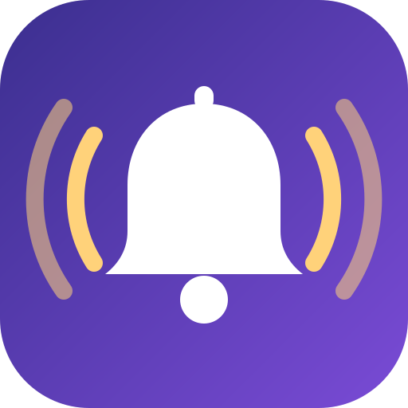

<p align="center">
  
</p>

<h1 align="center">agent-callback</h1>

<p align="center">
  <b>Get called back to your AI coding agent when it's waiting on you.</b>
</p>

<p align="center">
  <a href="https://github.com/akashmony01/agent-callback/releases/latest"></a>
  <a href="https://github.com/akashmony01/agent-callback/actions/workflows/ci.yml"></a>
  <a href="LICENSE"></a>
  
  
</p>

You start a long task in Claude Code, walk away, and it sits there for 20 minutes
waiting for a "yes" on a permission prompt. agent-callback fixes that:

- 🔔 **Desktop notification** titled with the project folder so you know *which*
  session needs you. It removes itself after a minute (no pile-up in your
  notification list) and comes back with each later burst of chimes.
- 🎵 **Gentle chime bursts**, not an endless alarm: 30 s right away, 60 s after
  5 minutes, 90 s after 10 more minutes, then silence.
- 🎹 **A different sound per session**, so with several sessions open you can
  tell them apart by ear.
- 🙈 **Quiet when you're away**: no sound while the screen is locked, and the later
  bursts are skipped if you haven't touched the keyboard or mouse for 15 minutes.
- ✋ **Stops by itself** the moment you reply, approve a permission prompt, or close
  the session. Clicking the notification takes you back to the right terminal
  tab or code editor window (VS Code, Cursor, Konsole, GNOME Terminal, Kitty, ...)
  on GNOME, KDE Plasma and X11 desktops.

> Unofficial community project, not affiliated with or endorsed by Anthropic.

## Install (Claude Code)

Inside Claude Code:

```
/plugin marketplace add akashmony01/agent-callback
/plugin install agent-callback@agent-callback
```

Or from a shell: `claude plugin marketplace add akashmony01/agent-callback && claude plugin install agent-callback@agent-callback`.

Start a new session (or run `/reload-plugins`) and you're done. Nothing is written
to your `settings.json`.

**Requirements:** `jq`, `python3` with `python3-gi` (PyGObject), `gdbus`, and a
sound player (`pw-play`, `paplay` or `aplay`). Stock Ubuntu, Fedora (GNOME or KDE)
and Linux Mint desktops already have all of them. On X11 desktops (Mint, XFCE,
MATE) also install `wmctrl` (or `xdotool`) so clicking a notification can raise
the window. On macOS, `afplay` is built in; install `jq` with `brew install jq`,
plus `brew install terminal-notifier` for clickable notifications.

### Optional: `hush` in your terminal

```bash
git clone https://github.com/akashmony01/agent-callback && cd agent-callback && ./install.sh
```

This adds `agent-callback` and `hush` to `~/.local/bin`. `./install.sh --uninstall` removes them.

## Stopping an alert

It stops on its own when you respond. To silence it by hand:

| Where | What to type | Silences |
|---|---|---|
| The notification | click it, or **Stop sound** | that session |
| Claude Code | `/agent-callback:hush` (or `/hush` if the name is free) | every session |
| Any terminal (after `./install.sh`) | `hush` | every session |

## Settings

Set these as environment variables before starting Claude Code, or put them in the
`"env"` block of `~/.claude/settings.json`:

| Variable | Default | Meaning |
|---|---|---|
| `AGENT_CALLBACK_DELAY` | `10` | Seconds to wait before alerting (reply within this and nothing happens) |
| `AGENT_CALLBACK_SCHEDULE` | `0:30 300:60 600:90` | Bursts as `wait:duration` in seconds |
| `AGENT_CALLBACK_AWAY_SECONDS` | `900` | Idle this long = away; bursts after the first are skipped |
| `AGENT_CALLBACK_SOUND` | *(rotates)* | Force one sound for all sessions: a name (`bell`, `Glass`) or a file path |
| `AGENT_CALLBACK_MAX_SECONDS` | `3600` | Hard limit for one alert |
| `AGENT_CALLBACK_NOTIFY_SECONDS` | `60` | How long the notification stays before removing itself (it comes back with each later burst). `0` keeps it until you dismiss it |
| `AGENT_CALLBACK_STATE_DIR` | `~/.local/state/agent-callback` | Where per-session state lives |
| `AGENT_CALLBACK_EDITOR` | *(auto)* | Editor command to focus when the notification is clicked (`code`, `cursor`, `codium`, `windsurf`); auto-detected |
| `AGENT_CALLBACK_LOG` | *(off)* | File to log every hook call and click-to-focus decision to, for troubleshooting |

Example, chimes every 2 minutes, 20 seconds each:

```json
{ "env": { "AGENT_CALLBACK_SCHEDULE": "0:20 120:20 120:20" } }
```

## Other AI tools

The core is a plain command, so any tool that can run a command when it's waiting
for you can use it:

```bash
agent-callback start --session <id> --app "My Agent" --cwd "$PWD" --message "Waiting for you"
agent-callback stop  --session <id>          # you responded
agent-callback stop  --session <id> --end    # session closed
agent-callback hush                          # silence everything
agent-callback status                        # what's running
```

Leave out `--session` to use the current terminal tab as the session. Only the
Claude Code adapter ships today. Adapters for other tools (Codex CLI, Gemini CLI,
Cursor, Aider, ...) are welcome: see `adapters/claude-code/hook.sh` for the pattern.

## Where it works

### Operating systems and desktops

| Platform | Sound | Notification | Click jumps back | Screen-lock silence | Away (idle) detection |
|---|---|---|---|---|---|
| **KDE Plasma 6** (Fedora, Kubuntu, ...), Wayland or X11 | ✅ tested | ✅ tested | ✅ tested | ✅ tested | ❌ (Plasma doesn't expose idle time) |
| **GNOME** (Ubuntu, Fedora Workstation), Wayland | ✅ tested | ✅ tested | ✅ tested (see below) | ✅ tested | ✅ tested |
| **Cinnamon / XFCE / MATE** (Linux Mint, ...), X11 | ✅ should work | ✅ should work | 🟡 untested, needs `wmctrl` or `xdotool` | 🟡 untested | 🟡 untested, needs `xprintidle` |
| KDE Plasma 5 | ✅ | ✅ | 🟡 untested | 🟡 untested | ❌ |
| Other Wayland compositors (Hyprland, Sway, ...) | ✅ | ✅ with a notification daemon (mako, dunst, ...) | ❌ | ❌ | ❌ |
| macOS | 🟡 untested | 🟡 untested | 🟡 untested, needs `terminal-notifier` (focuses the app, not a tab or window) | ❌ | 🟡 untested |
| Windows / WSL | ❌ not supported | ❌ | ❌ | ❌ | ❌ |

"Away" means: after the first burst, later bursts are skipped if you haven't
touched the keyboard or mouse for `AGENT_CALLBACK_AWAY_SECONDS`. Where idle time
can't be read, you're always treated as present.

### Where you run your agent (clicking the notification)

| Running in | Click takes you to | KDE Plasma | GNOME | X11 desktops |
|---|---|---|---|---|
| **VS Code** terminal | the VS Code window with your project | ✅ tested | ✅ tested (X11/XWayland VS Code, see below) | 🟡 untested |
| **Cursor / VSCodium / Windsurf / VS Code Insiders** terminal | that editor's window with your project | 🟡 untested | ✅ Cursor tested, others untested | 🟡 untested |
| **Konsole** | the exact tab | ✅ tested | ❌ (switches the tab, can't raise the window) | 🟡 untested |
| **GNOME Terminal** | the exact tab (GNOME first shows a "Terminal is ready" prompt; click it) | 🟡 untested | ✅ tested | 🟡 untested |
| **Kitty** | the exact tab/window, if remote control is on (`allow_remote_control yes` and `listen_on unix:/tmp/kitty` in `kitty.conf`); otherwise the window | 🟡 untested | ❌ | 🟡 untested |
| **WezTerm** | the exact pane | 🟡 untested | ❌ | 🟡 untested |
| **Ptyxis, Alacritty, XFCE Terminal, MATE Terminal, Tilix, xterm, ...** | the terminal window (not a specific tab) | 🟡 untested | ❌ | 🟡 untested |
| tmux / screen | the terminal window tmux runs in is not found | ❌ | ❌ | ❌ |
| JetBrains IDEs, Zed, Sublime Text | nothing | ❌ | ❌ | ❌ |
| macOS: Terminal, iTerm2, VS Code, WezTerm, Ghostty | that app (needs `terminal-notifier`) | | | 🟡 untested |

On GNOME, apps that run as native Wayland windows can't be raised by another
program, so there clicking only works for GNOME Terminal and for editors
running under XWayland (see below). KDE and X11 desktops don't have that limit.

**Code editors (VS Code, Cursor, ...):**

- The editor's command must be on your `PATH` on GNOME and X11 desktops
  (`code`, `cursor`, `codium`, `windsurf` or `code-insiders`). VS Code installs
  `code` for you. For Cursor run *"Shell Command: Install 'cursor' command"*
  from its command palette, or make a small `cursor` script that starts the
  AppImage. KDE doesn't need it.
- It brings the right **window** forward, not a particular terminal tab or
  chat panel inside it.
- With **one** window of that editor open, that window is raised. With
  **several**, the one whose title shows the session's project folder (or a
  folder above it) is raised. If none matches, nothing happens, so it never
  jumps to the wrong project or opens a new window.
- Projects are recognised by folder **name** in the window title. Two open
  projects with the same folder name (e.g. two `app` folders) can pick the
  wrong one. Multi-folder workspaces (`.code-workspace`) usually aren't
  matched, and a changed `window.title` setting can break matching.
- **GNOME only:** the editor must run under X11/XWayland so its windows can
  be read with `xprop`. Recent VS Code versions run as native Wayland apps by
  default; to get click-to-focus on GNOME, start it with
  `--ozone-platform=x11` (e.g. add `--ozone-platform=x11` to
  `~/.config/code-flags.conf`, or edit the `.desktop` file).

## How it works

- **Claude Code hooks** (`hooks/hooks.json` → `adapters/claude-code/hook.sh`)
  call the core command `bin/agent-callback`. `Stop` and the permission
  `Notification` start an alert. `UserPromptSubmit`, `PostToolUse` and
  `PostToolUseFailure` stop that session's alert. `SessionEnd` stops it and
  frees its sound.
- `agent-callback start` waits `AGENT_CALLBACK_DELAY` seconds, then shows the
  notification (`lib/agent-callback-notify.py`, a small Python/GLib program
  that speaks the freedesktop notification protocol and stays alive so it
  can close the notification later, since GNOME only lets the creator close
  it) and plays the chime bursts in a background loop. State and PIDs live in
  `~/.local/state/agent-callback/<session>/`.
- **Away / locked:** the lock state comes over D-Bus from GNOME, the
  freedesktop `ScreenSaver` interface (KDE and others), Cinnamon, MATE or
  XFCE. Idle time comes from GNOME (`org.gnome.Mutter.IdleMonitor`) or, on
  X11, from `xprintidle` if it's installed.
- **Remembering where you are:** when an alert starts, it records the chain
  of parent processes from the agent upwards (the terminal or editor that
  owns the window is one of them) and, for terminals that can switch tabs,
  which tab: Konsole (`KONSOLE_DBUS_*`), GNOME Terminal
  (`GNOME_TERMINAL_SCREEN`), Kitty (`KITTY_WINDOW_ID`), WezTerm
  (`WEZTERM_PANE`). This is saved in the session's `focus` file.
- **Clicking** runs `agent-callback __focus <state-dir>`, which first
  switches the tab (Konsole over D-Bus, GNOME Terminal through its search
  provider, `kitty @ focus-window`, `wezterm cli activate-pane`), then raises
  the window that belongs to the nearest of those processes:
  - **KDE Plasma:** loads a tiny KWin script (`lib/kwin-focus.js`) over
    D-Bus that picks the window and activates it. Works on Wayland and X11.
  - **X11 desktops:** reads windows with `xprop` and raises one with `wmctrl`
    or `xdotool`. For editors it runs `<editor> <folder>` instead, which makes
    the editor focus its own window.
  - **GNOME:** GNOME Terminal's tab activation; editors as on X11.
  - **macOS:** `terminal-notifier -activate <app>`; the app comes from
    `__CFBundleIdentifier` / `TERM_PROGRAM`.
- **Safety:** nothing goes over the network. Session ids are sanitised before
  being used as folder names. Recorded PIDs are checked against their command
  line before being killed, so a reused PID is never hit. Terminal tab ids are
  only used after checking that the tab really runs the agent.

## Adding another editor or terminal

VS Code-based editors need one word added to the `EDITORS` list in
`bin/agent-callback`: the name of the editor's binary, which you can see with
`readlink /proc/<pid>/exe`. To force it without code changes, set
`AGENT_CALLBACK_EDITOR=<launcher>`.

Terminals that own their windows are found automatically through the process
tree. Only tab switching needs code: add the terminal's tab id to
`save_focus_info` and the switch command to `focus_session`.

## Troubleshooting

- **No sound?** Run `AGENT_CALLBACK_DELAY=0 agent-callback start --message test`
  in a terminal (after `./install.sh`), then `hush`.
- **Not triggering in Claude Code?** Check `/hooks` lists the agent-callback hooks,
  and set `AGENT_CALLBACK_LOG=/tmp/agent-callback.log` to see every hook call.
- **Clicking doesn't jump back?** Set `AGENT_CALLBACK_LOG=/tmp/agent-callback.log`,
  trigger an alert, click it, and read the `focus:` lines in the log. Then
  check the matching row of the tables above. The session's
  `~/.local/state/agent-callback/<session>/focus` file shows what was
  detected (`host=editor`, `host=konsole`, ...). You can replay a click with
  `agent-callback __focus ~/.local/state/agent-callback/<session>`.
- **Cursor quits right after starting (AppImage)?** Some systems need it
  started with `--no-sandbox`. That's a Cursor issue, unrelated to agent-callback.
- **Sounds keep going after you replied?** If you answer "No" to a permission
  prompt, Claude Code doesn't always fire a hook. The alert still ends after its
  last burst, or run `hush`.

## Privacy and security

agent-callback makes no network connections and needs no `sudo`. It runs as you,
keeps its state in `~/.local/state/agent-callback/`, and talks only to your
desktop (notifications, lock/idle state, raising a window). See
[SECURITY.md](SECURITY.md) for details and how to report a vulnerability.

## Uninstall

```
/plugin uninstall agent-callback@agent-callback
/plugin marketplace remove agent-callback
```

and `./install.sh --uninstall` if you installed the terminal commands.

## Development

```bash
claude --plugin-dir ~/path/to/agent-callback     # load your working copy for one session
claude plugin validate ~/path/to/agent-callback  # check the manifests
```

Inside a session, `/reload-plugins` picks up edits.

### Releasing

1. Bump `version` in `.claude-plugin/plugin.json` and add a section for it
   to `CHANGELOG.md` (`## 0.2.0`).
2. Commit, then tag and push:

   ```bash
   git tag v0.2.0 && git push origin main v0.2.0
   ```

The `Release` GitHub Action (`.github/workflows/release.yml`) checks that the
tag matches `plugin.json`, runs syntax checks and ShellCheck, and publishes a
GitHub release whose notes are that version's `CHANGELOG.md` section.

## Contributing

Test reports from untested desktops, adapters for other AI tools, and support
for more terminals are very welcome. See [CONTRIBUTING.md](CONTRIBUTING.md).
Changes are listed in [CHANGELOG.md](CHANGELOG.md).

## License

[MIT](LICENSE)
